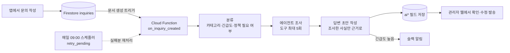
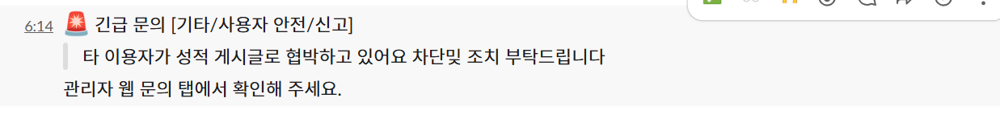
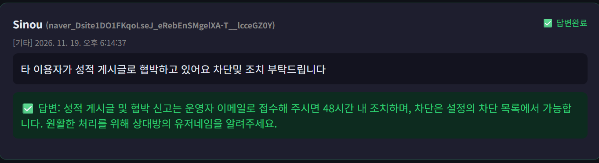
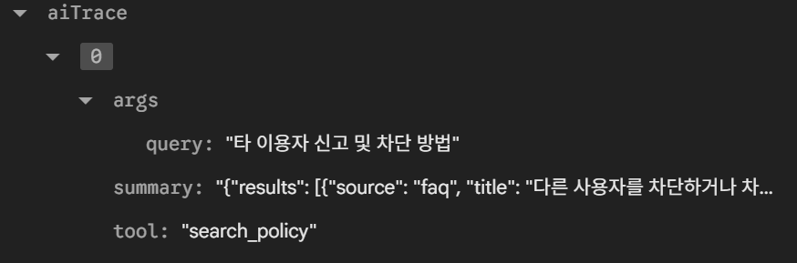
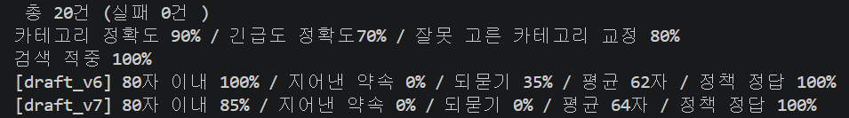

# InquiryAutoAns — 문의 답변 초안 AI 에이전트

취미 커뮤니티 앱 **HobbyHub**에 들어오는 고객 문의를 AI가 분류하고, 필요한 사실을 직접 조회해서 답변 초안을 만들어 주는 서비스입니다.
관리자는 초안을 확인하고 버튼 한 번으로 발송합니다. **자동 발송은 하지 않습니다.** 최종 판단은 항상 사람이 합니다.

> 앱 본체(HobbyHub)와 관리자 웹은 비공개 저장소이고, 이 저장소는 AI 처리 부분만 담고 있습니다.

---

## 왜 만들었나

1인 운영 앱이라 문의 답변이 늘 밀렸습니다. 문의 대부분은 아래 셋 중 하나였습니다.

- 정책 질문: "탈퇴하면 글도 지워지나요?", "유저네임은 몇 번 바꿀 수 있나요?"
- 계정 상태 확인: "어제 쓴 글이 사라졌어요" → 실제로 글 상태를 DB에서 찾아봐야 답할 수 있음
- 건의·칭찬: 감사 인사면 충분

답변 자체보다 **답하기 전에 찾아보는 시간**이 더 오래 걸렸습니다. 그래서 "찾아보기"까지 AI에게 맡기고, 사람은 확인과 발송만 하도록 만들었습니다.

---

## 동작 흐름



1. **분류** (`app/classifier.py`): 카테고리, 긴급도, 세부 유형, 정책 안내 필요 여부를 JSON 스키마로 받습니다.
2. **조사** (`app/agent.py`, `app/tools.py`): 에이전트가 문의를 보고 필요한 도구만 골라 호출합니다.
3. **작성** (`app/drafter.py`): 조사 결과와 정책 근거만 보고 80자 이내 초안을 씁니다. 근거에 없는 내용은 약속하지 않습니다.
4. **저장·알림** (`main.py`, `app/notify.py`): 결과를 문의 문서에 저장하고, 긴급하면 슬랙으로 알립니다.

---

## 에이전트가 쓰는 도구

| 도구 | 하는 일 | 언제 |
|---|---|---|
| `get_user_posts` | 문의자의 최근 글 10개와 상태(공개 / 본인 삭제 / 숨김) | 글이 사라졌다, 안 보인다 |
| `get_reports` | 문의자 글에 접수된 신고 건수와 사유 | 숨김 처리, 신고 문의 |
| `get_user_profile` | 레벨, 남은 유저네임 변경권 | 유저네임·레벨 문의 |
| `search_policy` | 약관·개인정보처리방침·FAQ에서 관련 문단 검색(RAG) | 앱 규칙, 사용법 문의 |

**도구 설계 원칙**

- **전부 읽기 전용**입니다. 에이전트는 DB를 바꿀 수 없습니다.
- **uid는 코드가 넣습니다.** LLM이 고를 수 있는 인자는 `search_policy`의 검색어 하나뿐이라, 프롬프트 조작으로 다른 사용자 데이터를 읽을 수 없습니다.
- **신고자 정보는 결과에 넣지 않습니다.** 건수와 사유만 돌려줍니다.
- 호출은 최대 5회, 같은 도구 반복 금지. 모든 호출은 `aiTrace`로 저장되어 관리자가 "왜 이렇게 답했는지" 확인할 수 있습니다.
- 자동 함수 실행을 끄고 루프를 직접 작성해서, 호출 횟수와 기록을 코드에서 통제합니다.

---

## 실제 동작 화면

| 슬랙 긴급 알림 | 관리자 웹 (모바일) | 에이전트 조사 기록 (aiTrace) |
|---|---|---|
|  |  |  |

---

## 성과 (직접 만든 평가 세트로 측정)

골든 문의 20건(`eval/golden.jsonl`)으로 프롬프트 버전마다 같은 기준으로 비교했습니다.

| 항목 | 개선 전 | 개선 후 |
|---|---|---|
| 정책 질문 정답률 (8건) | 1/8 (RAG 없음) | **8/8** (RAG, 3회 반복 측정 모두) |
| 정책 근거 검색 적중률 | - | **100%** |
| 답변 80자 이내 비율 | 0% (v1, 평균 172자) | 85~95% (v6) |
| 지어낸 약속 비율 | - | 0~5% |
| 사용자가 잘못 고른 카테고리 교정 | - | 4/4 |
| 사용자에게 되묻는 답변 비율 | 35% (v6) | **0%** (v7, 정책 정답 100% 유지) |

- 정책 질문은 **RAG 도입 전엔 그럴듯하게 지어냈습니다.** 예: "탈퇴해도 글은 삭제되지 않으니"(실제와 정반대). 키워드 검사는 통과해서, 수동 검수로 거짓 양성을 따로 걸러냈습니다.
- 검색은 정책 질문일 때만 합니다(분류 단계의 `needs_policy`). 모든 문의에 근거를 붙이면 건의 문의에도 "운영 정책에 따라" 같은 엉뚱한 문장이 섞였기 때문입니다.
- **되묻기 제거 (v6 → v7)**: 운영 중 협박 신고 문의에 "상대방의 유저네임을 알려주세요"라는 답이 나갔습니다. 문의는 답변 후 닫혀서 사용자가 답장할 수 없는 구조라, 되묻는 답은 사실상 막다른 길입니다. 평가 지표에 '되묻기 비율'을 추가해 측정하니 v6는 20건 중 7건(35%)이 되물었고, v7은 0건이었습니다. 정책 정답률은 100%를 유지했고, 80자 이내 비율은 100% → 85%로 조금 내려갔습니다(1회 측정).

  

- 에이전트 도구 선택은 대표 3케이스(글 사라짐 / 유저네임 / 건의)에서 3/3 정확했습니다. 8건짜리 에이전트 전용 평가 세트는 작업 중입니다.

> 답변 길이를 80자로 맞춘 이유: 답변이 푸시 알림 본문으로 그대로 발송되기 때문입니다.

---

## 기술 스택

- **LLM**: Google Gemini (`gemini-3.1-flash-lite`), 구조화 출력(Pydantic 스키마), Function Calling
- **검색**: `gemini-embedding-001` 임베딩 + 코사인 유사도 top-3 (정책 문서 34개 조각, 해시로 변경 감지 후 인덱스 재생성)
- **백엔드**: Python 3.12, Firebase Cloud Functions 2세대 (Firestore 트리거, Cloud Scheduler)
- **DB**: Cloud Firestore
- **알림**: Slack Incoming Webhook
- **관리자 웹**: Next.js (비공개 저장소, 반응형)

---

## 폴더 구조

```text
main.py              # Cloud Functions 진입점 (문의 생성 트리거, 매일 재처리)
app/
  classifier.py      # 1단계: 문의 분류
  agent.py           # 2단계: 도구 호출 루프
  tools.py           # 에이전트 도구 4개 (읽기 전용)
  retriever.py       # 정책 문서 RAG 검색
  drafter.py         # 3단계: 답변 초안
  pipeline.py        # 문의 1건 처리(process_one), 로컬 일괄 실행
  firebase_repo.py   # Firestore 읽기/쓰기
  notify.py          # 슬랙 알림
  retry.py           # 429/503 재시도, 일일 한도 초과 시 즉시 실패
  schemas.py         # 분류·초안 Pydantic 스키마
prompts/             # 프롬프트 버전별 보관 (classify_v1~v2, draft_v1~v6, agent_v1~v2)
policies/            # RAG 근거 문서 (약관, 개인정보처리방침, 안전 정책, FAQ)
eval/                # 골든 데이터셋과 평가 스크립트
```

프롬프트는 덮어쓰지 않고 버전별로 남깁니다. 평가 결과와 어떤 버전이 운영 중인지(`aiPromptVersion` 필드)를 같이 추적하기 위해서입니다.

---

## 로컬 실행

```bash
python -m venv venv
venv\Scripts\activate          # macOS/Linux: source venv/bin/activate
pip install -r requirements.txt
```

`.env.local`에 키를 넣고, Firebase 서비스 계정 키를 `secrets/serviceAccountKey.json`에 둡니다. 둘 다 git에 올라가지 않습니다.

```text
GEMINI_API_KEY=...
SLACK_WEBHOOK_URL=...
```

```bash
# 대기 중인 문의 1건을 에이전트로 처리 (저장 안 함)
python -m app.pipeline --limit 1 --agent

# 저장까지
python -m app.pipeline --limit 1 --agent --write

# 에이전트 단독 테스트
python -m app.agent <uid> "어제 쓴 글이 사라졌어요"

# 프롬프트 버전 비교 평가
python -m eval.run_eval --drafts draft_v2 draft_v6
```

---

## 배포

```bash
firebase functions:secrets:set AX_GEMINI_API_KEY
firebase functions:secrets:set SLACK_WEBHOOK_URL
firebase deploy --only functions:ai
```

- 앱 본체와 **같은 Firebase 프로젝트**에 배포하지만 `codebase: "ai"`로 분리해서, 앱 쪽 함수를 건드리지 않습니다.
- 키는 Secret Manager로만 전달합니다. 로컬 키 파일 이름을 `.env.local`로 둔 이유: Firebase CLI가 소스 폴더의 `.env`를 배포 환경변수로 자동 업로드하기 때문입니다.
- 클라우드에서는 서비스 계정 키 파일 없이 기본 인증으로 Firestore에 접속합니다.
- 인스턴스는 1개로 제한해서, 문의가 몰려도 Gemini 무료 한도(분당 15회)를 넘지 않게 했습니다.

---

## 안전 장치

- **사람 승인 후 발송**: AI는 초안만 만들고, 발송은 관리자 웹에서 사람이 합니다. 관리자가 초안을 고쳤는지(`aiDraftEdited`)도 기록합니다.
- **AI가 쓰는 필드는 `ai*` 접두어만**: 원본 문의 필드는 건드리지 않습니다.
- **무한 트리거 방지**: "문서 생성"에만 반응합니다. AI 결과를 저장하는 "수정"에는 반응하지 않습니다.
- **중복 처리 방지**: 이미 초안이 있거나 답변 완료된 문의는 건너뜁니다.
- **실패 처리**: 실패하면 슬랙에 에러 위치(Traceback)를 보내고, 다음 날 09시 스케줄러가 다시 처리합니다.

---

## 만들면서 겪은 문제

- **정책을 지어내는 문제** → RAG 도입. 단, 모든 문의에 근거를 붙이면 오히려 어색해져서 "정책 질문일 때만 검색"으로 바꿨습니다.
- **에이전트가 조회 결과를 초안에 반영하지 못함** → 조사가 끝나면 확인한 사실을 2문장으로 요약하게 하고, 그 요약을 근거 맨 앞에 넣었습니다. 오늘 날짜도 함께 넘겨서 "어제 쓴 글"을 계산할 수 있게 했습니다.
- **로컬에선 되는데 배포하면 컨테이너가 안 뜸** → 로컬 Python 3.14는 타입 힌트를 늦게 평가해서 오타가 숨어 있었고, 클라우드 3.12에서 import 시점에 터졌습니다. 배포 환경과 같은 버전으로 점검해야 한다는 걸 배웠습니다.
- **클라우드에서만 저장 실패** → 로컬 테스트를 저장 없이(`write=False`) 돌려서 저장 코드 경로를 한 번도 안 탔습니다. 실패 알림에 Traceback을 붙여서 원인 위치를 바로 찾았습니다.
- **무료 한도 소진** → 일일 한도(429 PerDay)는 재시도해도 소용없어서 즉시 실패로 처리하고, 분당 한도(429)와 일시 장애(503)만 대기 후 재시도합니다.

---

## 다음 계획

- 에이전트 전용 평가 세트(8건, 가짜 조회 데이터로 DB 없이 실행)로 도구 선택 정확도 측정
- v7 반복 측정으로 되묻기 0% 재현 확인, 80자 초과 3건 원인 분석
- 관리자 웹에 `aiTrace`(에이전트가 확인한 내용) 표시
